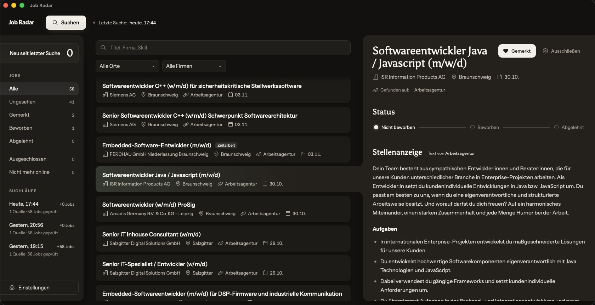

# German Job Radar

German Job Radar is a desktop app for job seekers in Germany. Still in early development. Currently it searches one job board with one search term, a place and a radius, and lists the jobs with their full descriptions. The UI is in German.

The goal is an app that collects new postings from several German sources into one deduplicated list, and uses  local AI to sort jobs based on how well they fit your profile. Your profile and jobs stay on your machine.



## Stack

- Backend: Spring Boot 4, Java 25, SQLite with Flyway
- Frontend: Angular 21, tests with Vitest
- Desktop: Tauri 2 shell around one Spring Boot jar plus a `jlink`-trimmed JRE
- Planned: Spring AI with Ollama and LM Studio

## Running it

JDK 25 and Node.js are required. The desktop build also needs Rust and the Tauri system dependencies for your OS.

For development, in two terminals:

```sh
cd backend && ./mvnw spring-boot:run   # API on 127.0.0.1:42420
cd frontend && npm start               # UI on http://localhost:4200
```

Tests:

```sh
cd backend && ./mvnw test
cd frontend && npx ng test
```

Builds:

```sh
scripts/run-jar.sh            # builds the frontend into the jar and runs it
scripts/package-desktop.sh    # jar + jlink runtime + Tauri installer for the current OS
scripts/install-mac.sh        # packages and installs to /Applications, macOS only
```

## Roadmap

- [x] **Arbeitsagentur end to end:** Search, load descriptions, list, read, track.
- [ ] **Full profile and relevance:** Level, experience, languages, skills and preferences in the profile, a relevance order from them, distance to the job, search on startup, zoom, resets.
- [ ] **AI:** A local decision model analyzes jobs and sorts out unrelated ones. Ollama and LM Studio supported. Automatic CV parsing.
- [ ] **More sources:** Arbeitnow and company career feeds (Personio, Greenhouse, Lever, Ashby, SmartRecruiters...)
- [ ] **Installers:** for MacOS, Linux, Windows built in GitHub Actions.

## Third-party notices

See [THIRD_PARTY_NOTICES.md](THIRD_PARTY_NOTICES.md).
